<h1 align="center">Kevin Mascarenhas</h1>

  

  <a href="#-português">🇧🇷 Português</a> &nbsp;•&nbsp;
  <a href="#-english">🇺🇸 English</a>

  
  

---

## 🇧🇷 Português

### Sobre mim

Engenheiro de Software em formação, focado em **resolver problemas reais com soluções práticas e bem estruturadas**. Para mim, a stack é uma ferramenta: o que importa é entender o problema, escolher a abordagem certa e entregar algo confiável, fácil de manter e pronto para crescer.

Na prática, já trabalhei com:

- **Arquitetura de sistemas:** separação de responsabilidades, serviços independentes e comunicação entre componentes, com base em princípios de **microsserviços**
- **Segurança e autenticação:** fluxos com **JWT**, controle de acesso e proteção de endpoints
- **APIs REST:** modelagem de recursos, versionamento e documentação clara para quem vai consumir
- **Dados:** modelagem relacional, persistência e **sincronização offline-first** entre dispositivos e servidor
- **Integração entre sistemas:** conectar back-end, mobile e serviços em nuvem de forma consistente

### Áreas de interesse

- Desenvolvimento full-stack e APIs
- Arquitetura de Software (Microsserviços, MVC)
- Bancos de dados relacionais e não relacionais
- Desenvolvimento mobile
- Análise e Ciência de Dados
- Inteligência Artificial

---

## 🇺🇸 English

### About me

Software Engineering student focused on **solving real problems with practical, well-structured solutions**. To me, a stack is a tool. What matters is understanding the problem, choosing the right approach and delivering something reliable, maintainable and ready to scale.

Hands-on experience with:

- **System architecture:** separation of concerns, independent services and inter-component communication, grounded in **microservices** principles
- **Security & authentication:** **JWT**-based flows, access control and endpoint protection
- **REST APIs:** resource modeling, versioning and clear documentation for consumers
- **Data:** relational modeling, persistence and **offline-first synchronization** between devices and server
- **Systems integration:** connecting back-end, mobile and cloud services consistently

### Areas of interest

- Back-end and API development
- Software Architecture (Microservices, MVC)
- Relational and non-relational databases
- Mobile development
- Data Analysis and Data Science
- Artificial Intelligence

---

## 🛠️ Tecnologias | Tech Stack

**Linguagens e Frameworks | Languages & Frameworks**

  

**Bancos de Dados e Ferramentas | Databases & Tools**

  

---

## 📊 GitHub

  

 

  <picture>
    <source media="(prefers-color-scheme: dark)" srcset="https://raw.githubusercontent.com/KevinMascarenhas/KevinMascarenhas/output/pacman-contribution-graph-dark.svg" />
    <source media="(prefers-color-scheme: light)" srcset="https://raw.githubusercontent.com/KevinMascarenhas/KevinMascarenhas/output/pacman-contribution-graph.svg" />
    
  </picture>

